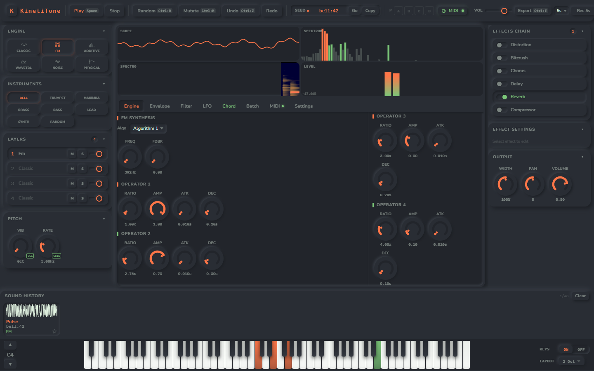
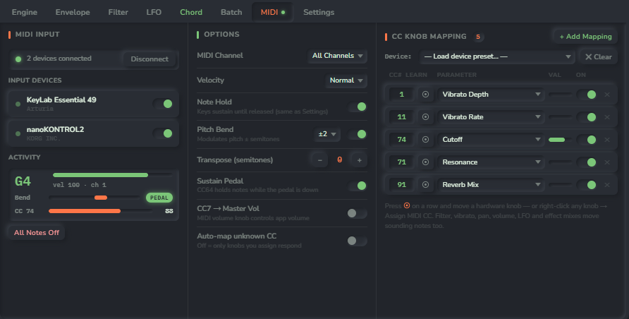
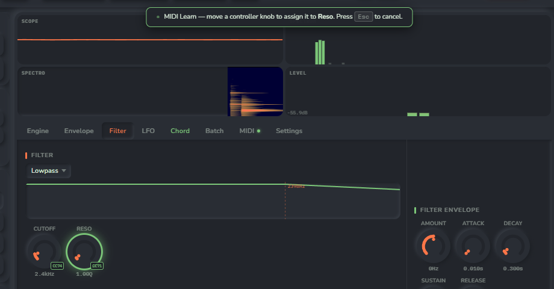
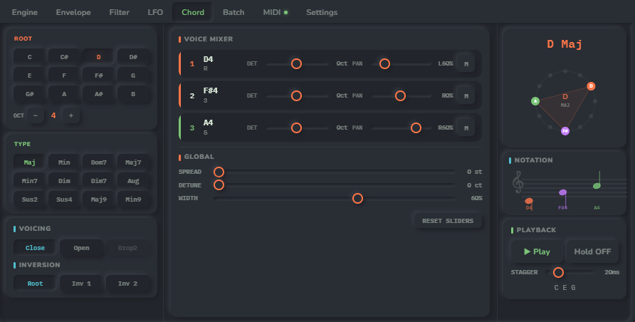

# 🎵 KinetiTone
### Generative Sound Designer - game SFX and playable instruments

**Free · Runs in your browser · No installation · MIDI controllers · Export .wav**

*Generate, shape and play sounds - right in your browser - then export them as .wav.*

---

## 🔗 [→ Open KinetiTone at kinetitone.com](https://kinetitone.com)

> KinetiTone is a free, browser-based generative sound designer for game developers, indie creators, musicians and sound designers. Press **Random**, tweak, play it on your keyboard or MIDI controller, export a .wav. No installation, no account.

### Where to use it

|  | 🌐 **[kinetitone.com](https://kinetitone.com)** - official site | 🎮 **[itch.io](https://in-the-void.itch.io/kinetitone)** |
|---|:---:|:---:|
| All engines, effects, chords, layers | ✅ | ✅ |
| WAV export and batch ZIP | ✅ | ✅ |
| **MIDI keyboards and controllers** | ✅ | - |
| Batch *Save to Folder* (Chrome / Edge) | ✅ | - |

> **Why no MIDI on itch.io?** itch.io runs browser games inside a frame, and browsers do not allow MIDI access from such frames. On **kinetitone.com** the app runs on its own page, so MIDI works.

---

## 📑 Contents

- [Features at a Glance](#-features-at-a-glance)
- [MIDI Controllers](#-midi-controllers)
- [Synthesis Engines](#️-synthesis-engines)
- [Effects Chain](#-effects-chain)
- [Chord Designer](#-chord-designer)
- [Seeds and Sharing](#-seeds-and-sharing)
- [Keyboard Shortcuts](#️-keyboard-shortcuts)
- [Sound License](#-sound-license)
- [FAQ](#-faq)

---

## ✨ Features at a Glance

| Feature | Description |
|---|---|
| 🎛️ **6 Synthesis Engines** | Classic, FM (4 operators), Additive (32 harmonics), Wavetable, Noise, Physical modelling |
| 🎲 **35 Sound Categories** | Lasers, coins, explosions, UI clicks, kicks, pads, piano, violin, choir, brass and more |
| 🎹 **MIDI Support** | Play with velocity, sustain pedal and pitch bend; map hardware knobs to any of 70 parameters - [details](#-midi-controllers) |
| 🧱 **4 Layers** | Stack up to 4 sounds, each with its own patch, Mute and Solo |
| 🎵 **Chord Designer** | 12 chord types, voicings, inversions, per-voice detune and pan, strum |
| ⌨️ **Playable Piano** | 88-key piano, play from your computer keyboard, Note Hold sustains while a key is down |
| ✨ **6 Effects** | Distortion, Bitcrush, Chorus, Delay, Reverb, Compressor |
| 🔀 **Randomize and Mutate** | A new sound in one click, or small variations of the current one |
| 🌱 **Seed System** | Every sound has a seed such as `bell:42` - share it and get the exact same sound back |
| 🎙️ **Live Recording** | Record a 3-15 s performance and keep it as a .wav |
| ⚡ **Batch Export** | Up to 32 sounds per batch, as a .ZIP or straight into a folder |
| 💾 **WAV Export** | 16-bit PCM or 32-bit float, 44.1 or 48 kHz, `Ctrl+E` |
| 📂 **Sound History** | Last 48 sounds with waveform previews and favourites |
| 🅰️ **Presets A-D** | Four quick slots for sounds you want to keep at hand |
| 🌍 **6 Languages** | English, Español, 中文, 日本語, Français, Deutsch |
| 🎨 **4 Themes** | Dark Neumorphic, Cosmic Purple, Sage & Navy, Earth Tones |

---

## 🎹 MIDI Controllers

> Available on **[kinetitone.com](https://kinetitone.com)** in Chrome, Edge or another Chromium browser on a computer.

### Quick start

1. Plug in your MIDI keyboard or controller (USB or a MIDI interface).
2. Open **[kinetitone.com](https://kinetitone.com)** and click **MIDI** in the top bar.
3. Allow MIDI access when the browser asks.
4. Click anywhere on the page once - browsers start audio only after a click - and play.

Your devices appear in the **MIDI** tab automatically, including ones you plug in later. A green dot on the **MIDI** button means you are connected. Next time KinetiTone reconnects by itself.

### What you can play

- **Notes with velocity** - choose how hard you need to hit: *Fixed*, *Soft*, *Normal* or *Hard*.
- **Note Hold** - a note sounds while the key is down and fades out with its release when you let go.
- **Sustain pedal** (CC64) - holds notes while the pedal is down.
- **Pitch bend** - bends notes that are already sounding, range ±1 to ±24 semitones.
- **Mod wheel** - vibrato depth out of the box.
- **Chords** - on the *Chord* tab every key you press plays the whole chord built on that note.

### Map your knobs and faders

Any knob in KinetiTone - all 70 of them - can follow a knob, fader or wheel on your controller.

**Fastest way - MIDI Learn on a knob:**
1. Right-click any knob → **Assign MIDI CC…**
2. Move a knob or fader on your controller.
3. Done - the knob now shows a small **CC** badge and follows your hardware.

**From the MIDI tab:** press **+ Add Mapping**, move a hardware control, then pick the parameter from the list (grouped into Pitch, Envelope, Filter, Modulation, Engine, Effects, Output). You can also type the CC number by hand.

**Device presets** set everything up in one click:
AKAI MPK Mini · AKAI MPK249 / MPK261 · Arturia MiniLab / KeyLab · Korg nanoKONTROL2 · Novation Launchkey · Behringer UMX / U-Control · Mod Wheel + Expression · GM Standard

**Mapped out of the box:**

| CC | Controller | Parameter |
|:---:|---|---|
| 1 | Mod wheel | Vibrato Depth |
| 11 | Expression | Vibrato Rate |
| 74 | Brightness | Filter Cutoff |
| 71 | Resonance | Filter Resonance |
| 91 | Reverb send | Reverb Mix |

- One hardware control drives one parameter: assigning a CC to a new knob frees it from the old one.
- Filter, vibrato, pan, volume, LFO and effect mixes change **notes that are already sounding**; other parameters apply from the next note.
- Moving a control is a single step for **Undo** (`Ctrl+Z`).
- To remove a mapping, right-click the knob → **Remove MIDI CC**, or press ✕ in the MIDI tab.

### Options

| Option | What it does |
|---|---|
| **MIDI Channel** | Listen to all channels or just one (1-16) |
| **Velocity** | Fixed, Soft, Normal or Hard response |
| **Note Hold** | Hold notes while keys are down (same switch as in Settings) |
| **Pitch Bend** | On / off and range ±1 to ±24 semitones |
| **Transpose** | −24 to +24 semitones; hold **Shift** on −/+ to move a whole octave |
| **Sustain Pedal** | CC64 holds notes while the pedal is down |
| **CC7 → Master Vol** | Your controller's volume fader drives the app volume |
| **Auto-map unknown CC** | Any new control you move binds itself to a free parameter |
| **All Notes Off** | Stops every note at once if something hangs |

Your mappings and options are remembered in your browser.

### MIDI troubleshooting

| Problem | Fix |
|---|---|
| The device is not listed | Check the cable, then close other music apps: on Windows a DAW can keep the device to itself |
| "Access denied" | Click the lock icon in the address bar → allow **MIDI devices** → press **Connect** |
| Keys light up but there is no sound | Click once anywhere on the page - the browser needs one click before it plays audio |
| A note keeps ringing | Press **All Notes Off** in the MIDI tab |
| "Not supported in this browser" | Use Chrome or Edge on a computer. Safari has no Web MIDI; Firefox asks you to install a site permission first |

---

## 🎛️ Synthesis Engines

- **Classic** - sine, square, saw, triangle and noise with unison and detune
- **FM** - 4 operators, 8 algorithms and feedback for bells, basses and metallic tones
- **Additive** - draw 32 harmonics by hand or start from a preset shape
- **Wavetable** - morph between waveforms, with auto-scan
- **Noise** - sculpt white, pink, brown or blue noise band by band for textures, hits and ambience
- **Physical** - modelled plucked strings, drums and wind instruments

---

## 🎧 Effects Chain

Switch each effect on or off and dial it in; the order is fixed for a clean, predictable sound:

`Distortion` → `Bitcrush` → `Chorus` → `Delay` → `Compressor` → `Reverb`

---

## 🎵 Chord Designer

Pick a root and one of 12 chord types (Maj, Min, Dom7, Maj7, Min7, Dim, Dim7, Aug, Sus2, Sus4, Maj9, Min9), choose the voicing and inversion, then shape each voice with its own detune and pan. Strum with **Stagger**, or **Hold** the chord. Play it from the piano, your computer keyboard or a MIDI keyboard - each key plays the chord on that note.

---

## 🌱 Seeds and Sharing

Every generated sound has a seed, for example `bell:42`. Type it into the **Seed** field and press **Go** to get exactly the same sound back on any computer. **Copy** puts the seed on your clipboard, ready to share.

A seed brings back the sound as it was generated. To keep your own edits, save the sound to a preset slot **A-D** (right-click a slot) or use **Export JSON** in Settings.

---

## ⌨️ Keyboard Shortcuts

| Keys | Action |
|---|---|
| `Space` | Play |
| `Ctrl+R` | Randomize |
| `Ctrl+M` | Mutate |
| `Ctrl+Z` / `Ctrl+Y` | Undo / Redo |
| `Ctrl+E` | Export .wav |
| `[` / `]` | Piano octave down / up |
| `Shift+S` | Settings |
| `F11` | Fullscreen |

Letter and number keys play the piano (four layouts to choose from in Settings). Every shortcut can be changed in **Settings → Hot Keys**; on a Mac some defaults differ so they do not clash with system shortcuts.

---

## 📄 Sound License

All sounds you export from KinetiTone are **100% yours**. Use them freely in:
- ✅ Commercial games and apps
- ✅ YouTube videos and streams
- ✅ Music productions
- ✅ Podcasts and films

The only restriction: do not resell exported sounds as-is (e.g. as a sample pack without transformation).

---

## 🚀 Who Is It For?

- **Game developers** - SFX for any genre in seconds
- **Indie musicians** - new timbres and textures, playable from a MIDI keyboard
- **Sound designers** - rapid prototyping with deep control and hardware knobs
- **Game jam participants** - batch-generate whole sound libraries fast
- **Beginners** - no experience needed, just hit **Random**

---

## ❓ FAQ

**Is it really free?**
Yes, completely free. No account needed. Runs in your browser.

**Which site should I use?**
[kinetitone.com](https://kinetitone.com) is the official site and has everything, including MIDI. The [itch.io](https://in-the-void.itch.io/kinetitone) version is the same app without MIDI.

**Does it support MIDI?**
Yes - on [kinetitone.com](https://kinetitone.com): keyboards, pads, knobs, faders, sustain pedal and pitch bend. See [MIDI Controllers](#-midi-controllers).

**Will my sounds be saved?**
Yes - KinetiTone keeps your project, sound history, presets and MIDI mappings in your browser. Nothing is lost on refresh. You can also export everything as a JSON file.

**What browsers are supported?**
Chrome and Edge are recommended (and required for MIDI). Firefox works too. Brave may cause performance issues.

**Can I suggest features?**
Absolutely → [inthevoidhelp@gmail.com](mailto:inthevoidhelp@gmail.com) or leave a comment on itch.io.

---

## 🔗 Links

- 🌐 **Official site (with MIDI)** → [kinetitone.com](https://kinetitone.com)
- 🎮 **itch.io page** → [in-the-void.itch.io/kinetitone](https://in-the-void.itch.io/kinetitone)
- ☕ **Support on Ko-fi** → [ko-fi.com/inthevoident](https://ko-fi.com/inthevoident)
- 📧 **Contact** → [inthevoidhelp@gmail.com](mailto:inthevoidhelp@gmail.com)
- 🎨 **More tools by In The Void** → [in-the-void.itch.io](https://in-the-void.itch.io)

---

## ⚖️ Legal

**KinetiTone** is proprietary software. Source code is not publicly available.

**Sounds you export** are 100% yours - use them freely in commercial
and non-commercial projects, games, videos, and music.

© 2026 In The Void. All rights reserved.

Made with ❤️ by **In The Void** · Free forever

